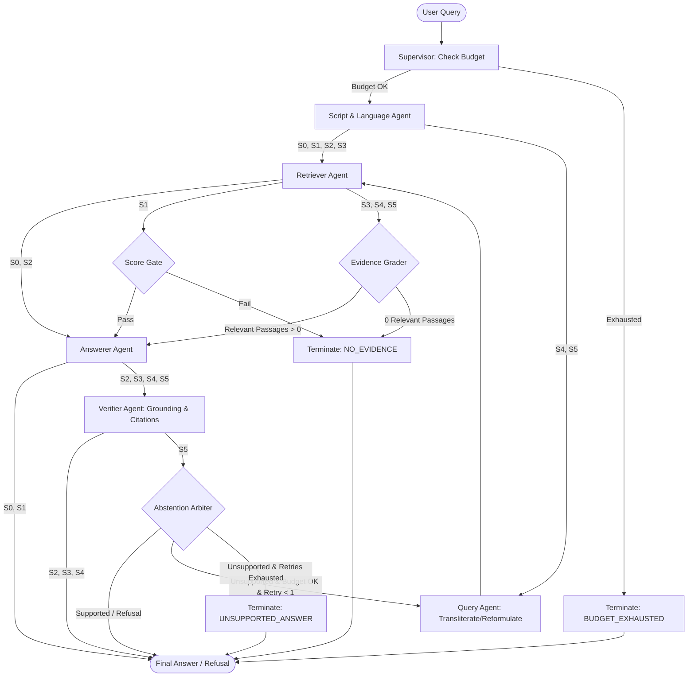

# Phase 5 Walkthrough: Multi-Agent System Architecture & Systems Ladder

## 1. Executive Summary

Phase 5 establishes the modular, typed multi-agent serving architecture for **PJ-09 IndicRAG-QA** using **LangGraph** and **Pydantic**.

Key accomplishments in this phase:
- **Typed StateGraph (`src/indicrag/agents/`):** Implemented `IndicRAGState` enforcing validated state transitions, script tracking, language tracking, provenance tracking, execution telemetry, and standardized `ReasonCode` enumerations (`NO_EVIDENCE`, `UNSUPPORTED_ANSWER`, `ANSWERER_REFUSED`, `LOW_CONFIDENCE`, `BUDGET_EXHAUSTED`, `CONTRADICTORY_EVIDENCE`).
- **Full Planned Architecture Implemented:**
  1. `SupervisorAgent`: Enforces hard budgets (8 LLM calls, 2 retrieval rounds) and routes ladder configurations.
  2. `ScriptLanguageAgent`: Discriminates Devanagari Hindi, Roman-script Hinglish, and English.
  3. `QueryAgent`: Performs rule-based transliteration of Roman Hinglish to Devanagari and retry reformulations.
  4. `RetrieverAgent`: Orchestrates hybrid retrieval over the search corpus.
  5. `ScoreGate`: Non-agentic retrieval score threshold gating (System S1).
  6. `EvidenceGraderAgent`: Grades topical relevance and filters out counterfactual distractors and noise.
  7. `AnswererAgent`: Synthesizes grounded answers strictly from graded passages with inline citations `[psg_xxx]`.
  8. `VerifierAgent`: Validates claim-level support and citation fidelity using Unicode Indic tokenization.
  9. `AbstentionArbiter`: Arbitrates final output, manages bounded retries (max 1 retry loop), and assigns typed reason codes.
- **Experimental Systems Ladder (S0 through S5):** All 6 planned configurations are independently constructible, runnable, and verified under the same evaluation harness.
- **Budget & Loop Enforcement:** Strict deterministic termination upon budget exhaustion (`BUDGET_EXHAUSTED`). Loops cannot bypass budget limits.
- **Offline Judge Isolation:** Re-verified that the Judge Agent cannot be imported or executed in the serving pipeline (AGENTS.md Rule 14).
- **Test Suite Status:** **56 / 56 tests passing (100% green in 19.07s)** across all Phases 0–5.

---

## 2. Multi-Agent Architecture & StateGraph Blueprint

### StateGraph Routing Diagram



---

## 3. Systems Ladder Comparison Matrix (S0 to S5)

Each system configuration isolates the empirical contribution of successive agent roles:

| System | Name | Active Agents | Flow Description | Research Hypothesis |
| :---: | :--- | :--- | :--- | :--- |
| **S0** | Single-pass RAG | Retriever, Answerer | Script -> Retriever -> Answerer -> END | Baseline standard RAG without verification or gating. |
| **S1** | Score-Gated RAG | Retriever, ScoreGate, Answerer | Script -> Retriever -> ScoreGate -> Answerer / Abstain | Non-agentic threshold gate filters unanswerable queries cheaply without LLM calls. |
| **S2** | Verifier RAG | Retriever, Answerer, Verifier | Script -> Retriever -> Answerer -> Verifier -> Decision | Verifier catches hallucinations and citation errors after answer generation. |
| **S3** | Graded Verifier RAG | Retriever, Grader, Answerer, Verifier | Script -> Retriever -> Grader -> Answerer -> Verifier -> Decision | Evidence Grader removes distractors before the Answerer sees them, reducing confusion. |
| **S4** | Query-Adapted RAG | Script/Lang, QueryAgent, Retriever, Grader, Answerer, Verifier | Script/Lang -> QueryAgent -> Retriever -> Grader -> Answerer -> Verifier -> Decision | Transliteration and normalization resolve the cross-script retrieval barrier for Hinglish. |
| **S5** | Full Multi-Agent | All Agents + Abstention Arbiter | Full pipeline with bounded retry loop back to QueryAgent upon verification failure | Bounded self-correction recovers from borderline retrieval or drafting failures. |

---

## 4. Execution Budget Enforcement & Bounded Retries

AGENTS.md Rule 12 and the Master Brief specify hard constraints to ensure cost control and prevent infinite loops:

### Budget Limits
- **Maximum LLM Calls:** **8 calls** per query across all nodes.
- **Maximum Retrieval Rounds:** **2 rounds** per query.
- **Maximum Bounded Retries (S5):** **1 retry loop** (`max_retries = 1`), contingent on remaining LLM call budget (`llm_calls <= max_llm_calls - 2`).

### Deterministic Reason Codes
When the system abstains, it assigns a standardized typed `ReasonCode`:
1. `NO_EVIDENCE`: Retrieval yielded no passages, score fell below gating threshold, or Evidence Grader filtered all candidates.
2. `UNSUPPORTED_ANSWER`: Verifier detected claims unsupported by cited evidence, and retry budget was exhausted.
3. `ANSWERER_REFUSED`: Answering model explicitly stated that context lacks sufficient information.
4. `LOW_CONFIDENCE`: Model confidence fell below operational threshold.
5. `BUDGET_EXHAUSTED`: Hard limit of 8 LLM calls or 2 retrieval rounds reached before consensus.
6. `CONTRADICTORY_EVIDENCE`: Retrieved passages contain mutually contradictory facts.

---

## 5. Grounding, Citation Fidelity & Verification Details

### Unicode-Aware Tokenization
Devanagari scripts use vowel matras, halants, and anusvaras that standard ASCII word delimiters (`\w+`) improperly split. The Evidence Grader and Verifier utilize Unicode-aware Indic tokenization (`tokenize_indic`) to preserve complete word tokens (`['भारत', 'की', 'राजधानी', 'क्या', 'है']`).

### Verification Checks:
1. **Citation Existence Check:** Verifies that every `[psg_xxx]` cited in the draft answer exists in the retrieved/graded passage collection. Citing a missing ID immediately flags a citation hallucination (`UNSUPPORTED`).
2. **Claim Grounding Check:** Splits answer into individual claims, strips non-lexical markers, and verifies content word overlap against the cited passages (support threshold $\ge 0.75$).
3. **Citation Metrics Distinction:**
   - **Citation Precision:** $\frac{|\text{Valid Cited Passages}|}{|\text{Total Cited Passages}|}$ (evaluates citation existence).
   - **Citation Support / Grounding:** $\frac{|\text{Supported Claims}|}{|\text{Total Claims}|}$ (evaluates whether the cited text actually supports the claim).

---

## 6. Offline Judge Isolation & Zero Leakage

To comply with AGENTS.md Rule 14:
- The `JudgeAgent` is strictly an offline evaluation tool (`google/gemini-2.0-flash`).
- Attempting to invoke `JudgeAgent.evaluate_item(..., is_serving_pipeline=True)` raises a strict `RuntimeError`.
- Unit test `test_judge_agent_offline_isolation_in_graph` asserts this boundary.
- Unit test `test_no_gold_answers_leakage_in_state` asserts that `IndicRAGState` contains zero gold answer fields, labels, or unanswerability flags.

---

## 7. Regression Test Suite Evidence

All 56 automated tests pass across all project modules:
```powershell
pytest tests/ -v
============================= 56 passed in 19.07s =============================
```
- `tests/test_hinglish_pipeline.py`: 6 passed
- `tests/test_leakage.py`: 11 passed
- `tests/test_phase0_smoke.py`: 5 passed
- `tests/test_phase2_noise.py`: 6 passed
- `tests/test_phase3_retrieval.py`: 8 passed
- `tests/test_phase4_eval.py`: 9 passed
- `tests/test_phase5_agents.py`: 11 passed:
  1. `test_pydantic_state_schema_and_enums`: PASSED
  2. `test_script_language_agent_detection`: PASSED
  3. `test_query_agent_transliteration_and_reformulation`: PASSED
  4. `test_supervisor_budget_enforcement`: PASSED
  5. `test_score_gate_s1_behavior`: PASSED
  6. `test_evidence_grader_filtering_and_abstention`: PASSED
  7. `test_verifier_grounding_and_citation_fidelity`: PASSED
  8. `test_abstention_arbiter_bounded_retry_and_termination`: PASSED
  9. `test_system_ladder_execution_s0_through_s5`: PASSED
  10. `test_judge_agent_offline_isolation_in_graph`: PASSED
  11. `test_no_gold_answers_leakage_in_state`: PASSED

---

## 8. Gate Stop & Review Request

In accordance with project rules, work is **stopped at the Phase 5 approval gate**.
Ready for review before proceeding to **Phase 6: Multi-Agent Benchmark Experiments, Normalization Ablations, and Evaluation**.
