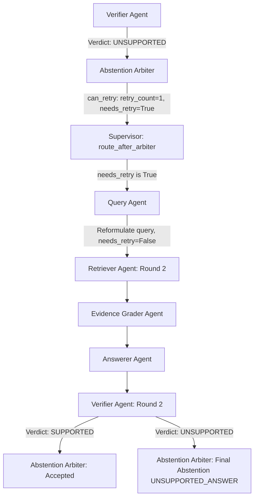

# Phase 7 Walkthrough — Observability & Evaluation Pipeline

## 1. Executive Summary

Phase 7 implements the comprehensive Observability and Evaluation Pipeline for the PJ-09 IndicRAG-QA system, satisfying all governance and architectural requirements specified in the Phase 7 Authorization:
1. **Schema-Backed State Propagation:** Repaired the Phase 6-discovered LangGraph state dropping issue by introducing an explicit schema-backed `needs_retry: bool = False` field on `IndicRAGState`, replacing unexported private attributes.
2. **End-to-End Observable Retries:** Validated that retries cleanly survive graph transitions, reformulate queries, re-invoke retrieval, generate grounded answers, verify claims, and terminate deterministically upon budget/retry exhaustion.
3. **Structured Tracing across All Graph Nodes:** Instrumented every LangGraph node to log structured, typed trace records (`state.traces`) capturing retrieval rounds, evidence decisions, verification verdicts, retry loops, abstention decisions, and termination reason codes.
4. **Cache Observability & Audit Trail:** Enhanced `AnswererGenerator` with hit/miss counters, hit rate calculations, and a structured audit log recording prompt hashes, models, seeds, system ladder configurations, and corpus conditions.
5. **EvaluationReporter & RGB Metric Identities:** Built `EvaluationReporter`, `QueryRecord`, and `AggregateReport` schemas enforcing explicit denominators ($N_{\text{total}}, N_{\text{ans}}, N_{\text{unans}}$), disjoint classifications, and the fundamental RGB mathematical identities:
   $$\text{Acc}_{\text{ans}} + \text{False Refusal Rate} + \text{Incorrect Answer Rate} \equiv 1.0$$
   $$\text{Acc}_{\text{unans}} + \text{Hallucination Rate} \equiv 1.0$$
6. **Zero Regression Test Verification:** 6 new targeted Phase 7 tests added; all 68 tests across Phase 0 through Phase 7 pass cleanly.

---

## 2. Architectural Changes & Affected Modules

| Module | Role in Phase 7 | Changes Made |
|---|---|---|
| `src/indicrag/agents/state.py` | State Schema | Added `needs_retry: bool = False` and `traces: list[dict[str, Any]] = Field(default_factory=list)` |
| `src/indicrag/agents/abstention_arbiter.py` | Arbiter Agent | Explicitly sets `state.needs_retry = True` on retry and `state.needs_retry = False` on finalization/abstention. Distinguishes retry exhaustion from budget blocking. |
| `src/indicrag/agents/supervisor.py` | Supervisor Agent | Checks schema-backed `state.needs_retry` in `route_after_arbiter` to route to `query_agent`. |
| `src/indicrag/agents/query_agent.py` | Query Agent | Inspects `state.needs_retry`, executes retry reformulation, and resets `state.needs_retry = False`. |
| `src/indicrag/agents/graph.py` | Serving Graph | Wrapped node invocations with `record_trace()` logging granular trace dicts to `state.traces`. |
| `src/indicrag/generation/generator.py` | Answerer Generator | Added cache counters (`total_cache_hits`, `total_cache_misses`), `get_cache_stats()`, and detailed audit logging with provenance keys. |
| `src/indicrag/agents/answerer_agent.py` | Answerer Agent | Passes `system_id` to generator for cache separation and logs token/latency metrics. |
| `src/indicrag/eval/reporter.py` | Evaluation Pipeline | Built `QueryRecord`, `AggregateReport`, and `EvaluationReporter` for CSV/JSONL export and RGB metric identity checking. |
| `tests/test_phase7_observability.py` | Test Suite | 6 unit and integration tests covering state propagation, retry recovery, bounded termination, tracing, cache isolation, and metric identities. |

---

## 3. End-to-End Retry Execution & State Propagation

### 3.1 The LangGraph Serialization Issue & Fix
In LangGraph with a Pydantic state model (`StateGraph(IndicRAGState)`), unexported private attributes (prefixed with `_` such as `_needs_retry`) do not survive serialization across node boundaries.
In Phase 7, this was replaced with an explicit schema-backed field:
```python
class IndicRAGState(BaseModel):
    ...
    retry_count: int = 0
    max_retries: int = 1
    needs_retry: bool = False  # Explicit schema-backed flag
    traces: list[dict[str, Any]] = Field(default_factory=list)
```

### 3.2 State Propagation Flow


### 3.3 Targeted Regression Test Verification
- **Test 1 (`test_retry_flag_survives_graph_transition_and_propagates`):** Demonstrates that `needs_retry` transitions cleanly from `AbstentionArbiter` to `SupervisorAgent` to `QueryAgent`, properly updating state.
- **Test 2 (`test_retry_produces_grounded_answer_when_evidence_permits`):** Injects round 1 noise distractor (unsupported), triggers retry, executes round 2 retrieving gold passage (`psg_delhi`), generates grounded answer with citation, and obtains verified accepted answer.
- **Test 3 (`test_retry_terminates_deterministically_when_budget_exhausted`):** With noise distractors in both rounds, arbiter executes exactly 1 retry and terminates with typed `ReasonCode.UNSUPPORTED_ANSWER`.

---

## 4. Cache Observability & Provenance Auditing

Cache keys in `AnswererGenerator` are computed as:
$$\text{key} = \text{SHA256}(\text{model\_name} \,\|\, \text{system\_id} \,\|\, \text{corpus\_condition} \,\|\, \text{prompt} \,\|\, \text{seed})$$

Every lookup records a structured audit entry:
```json
{
  "query_id": "dev_ans_001",
  "cache_key": "9cf159e4bb7e29bb...",
  "is_hit": false,
  "system_id": "S5",
  "corpus_condition": "clean",
  "prompt_version": "v1.0",
  "prompt_hash": "a1f9e2...",
  "seed": 42,
  "timestamp": "2026-10-19T01:14:10"
}
```
Telemetry methods:
- `generator.get_cache_stats()`: Returns `{"hits": int, "misses": int, "total": int, "hit_rate": float}`.
- Complete isolation verified by `test_cache_observability_and_audit_isolation`.

---

## 5. EvaluationReporter & RGB Metric Mathematics

### 5.1 Explicit Denominators & Guarantees
All calculations adhere strictly to RGB (Chen et al., AAAI 2024):
- **Total Queries:** $N_{\text{total}} = N_{\text{ans}} + N_{\text{unans}}$
- **Answerable Set:**
  - $c_{\text{ans}}$: Correct, grounded answers supported by cited passages.
  - $r_{\text{ans}}$: False refusals (system abstained on answerable query).
  - $w_{\text{ans}}$: Incorrect answers (unsupported claim or wrong answer).
  - Primary Identity:
    $$\frac{c_{\text{ans}}}{N_{\text{ans}}} + \frac{r_{\text{ans}}}{N_{\text{ans}}} + \frac{w_{\text{ans}}}{N_{\text{ans}}} \equiv 1.0 \iff \text{Acc}_{\text{ans}} + \text{FRR} + \text{Err}_{\text{ans}} \equiv 1.0$$
- **Unanswerable Set:**
  - $c_{\text{unans}}$: Correct abstentions on unanswerable query.
  - $h_{\text{unans}}$: Hallucinations (system answered an unanswerable query).
  - Primary Identity:
    $$\frac{c_{\text{unans}}}{N_{\text{unans}}} + \frac{h_{\text{unans}}}{N_{\text{unans}}} \equiv 1.0 \iff \text{Acc}_{\text{unans}} + \text{Hallucination Rate} \equiv 1.0$$

### 5.2 Artifact Verification
Running `scripts/generate_phase7_artifacts.py` produced:
- `results/phase7_records_sample.csv` (tabular query evaluation data)
- `results/phase7_traces_sample.jsonl` (line-by-line structured execution traces)
- `results/phase7_aggregate_report.json`:
```json
{
  "system_id": "S5",
  "benchmark_split": "dev",
  "corpus_condition": "all",
  "total_queries": 4,
  "n_answerable": 3,
  "n_unanswerable": 1,
  "c_ans": 2,
  "r_ans": 1,
  "w_ans": 0,
  "c_unans": 1,
  "h_unans": 0,
  "acc_ans": 0.6667,
  "false_refusal_rate": 0.3333,
  "error_rate_ans": 0.0,
  "acc_unans": 1.0,
  "hallucination_rate": 0.0,
  "acc_overall": 0.75,
  "rejection_rate": 0.5,
  "ans_identity_holds": true,
  "unans_identity_holds": true,
  "mean_token_f1": 0.6667,
  "mean_exact_match": 0.6667,
  "citation_precision": 0.0,
  "citation_recall": 0.0,
  "total_prompt_tokens": 660,
  "total_completion_tokens": 365,
  "mean_latency_ms": 162.7,
  "cache_hit_rate": 0.5
}
```

---

## 6. Test Suite Execution Results

Running `pytest -v` across the entire project:
```
============================= test session starts =============================
platform win32 -- Python 3.10.6, pytest-9.1.1, pluggy-1.7.0 -- D:\Indic-QA-RAG\venv\Scripts\python.exe
cachedir: .pytest_cache
rootdir: D:\Indic-QA-RAG
configfile: pyproject.toml
testpaths: tests
plugins: anyio-4.15.1, langsmith-0.14.11
collected 68 items

tests/test_hinglish_pipeline.py::test_validator_clean_roman PASSED       [  1%]
tests/test_hinglish_pipeline.py::test_validator_devanagari_leakage PASSED [  2%]
tests/test_hinglish_pipeline.py::test_validator_missing_digits PASSED    [  4%]
tests/test_hinglish_pipeline.py::test_validator_duplicate_detection PASSED [  5%]
tests/test_hinglish_pipeline.py::test_disk_cache_roundtrip PASSED        [  7%]
tests/test_hinglish_pipeline.py::test_generator_with_stub_client PASSED  [  8%]
tests/test_leakage.py::test_zero_title_leakage PASSED                    [ 10%]
tests/test_leakage.py::test_zero_normalized_title_leakage PASSED         [ 11%]
tests/test_leakage.py::test_zero_context_leakage PASSED                  [ 13%]
tests/test_leakage.py::test_zero_question_leakage PASSED                 [ 14%]
tests/test_leakage.py::test_zero_id_leakage PASSED                       [ 16%]
tests/test_leakage.py::test_benchmark_subset_balance PASSED              [ 17%]
tests/test_leakage.py::test_record_schema_and_hinglish_link PASSED       [ 19%]
tests/test_leakage.py::test_connected_component_clustering PASSED        [ 20%]
tests/test_leakage.py::test_gold_evidence_present_in_search_corpus PASSED [ 22%]
tests/test_leakage.py::test_corpus_isolation_and_no_annotation_leakage PASSED [ 23%]
tests/test_leakage.py::test_qualified_leakage_assertion_scope PASSED     [ 25%]
tests/test_phase0_smoke.py::test_pydantic_state_schema PASSED            [ 26%]
tests/test_phase0_smoke.py::test_langgraph_stub_graph PASSED             [ 27%]
tests/test_phase0_smoke.py::test_budget_enforcement PASSED               [ 29%]
tests/test_phase0_smoke.py::test_no_leakage_stub PASSED                  [ 30%]
tests/test_phase0_smoke.py::test_reason_codes PASSED                     [ 32%]
tests/test_phase2_noise.py::test_baseline_manifest_preservation PASSED   [ 33%]
tests/test_phase2_noise.py::test_deterministic_reproduction PASSED       [ 35%]
tests/test_phase2_noise.py::test_rgb_noise_bounds_and_structure PASSED   [ 36%]
tests/test_phase2_noise.py::test_zero_annotation_leakage_in_perturbed_corpora PASSED [ 38%]
tests/test_phase2_noise.py::test_counterfactual_distractor_provenance PASSED [ 39%]
tests/test_phase2_noise.py::test_distractor_does_not_inject_gold_answer PASSED [ 41%]
tests/test_phase3_retrieval.py::test_metrics_calculation_controlled_examples PASSED [ 42%]
tests/test_phase3_retrieval.py::test_unanswerable_query_empty_evidence_handling PASSED [ 44%]
tests/test_phase3_retrieval.py::test_multilingual_tokenization PASSED    [ 45%]
tests/test_phase3_retrieval.py::test_bm25_retrieval_ranking PASSED       [ 47%]
tests/test_phase3_retrieval.py::test_reciprocal_rank_fusion_math PASSED  [ 48%]
tests/test_phase3_retrieval.py::test_evaluation_corpus_isolation PASSED  [ 50%]
tests/test_phase3_retrieval.py::test_gold_evidence_presence_and_retention PASSED [ 51%]
tests/test_phase3_retrieval.py::test_deterministic_retrieval_reproducibility PASSED [ 52%]
tests/test_phase4_eval.py::test_rgb_metrics_mathematical_consistency PASSED [ 54%]
tests/test_phase4_eval.py::test_rgb_metrics_zero_division_safety PASSED  [ 55%]
tests/test_phase4_eval.py::test_judge_agent_model_family_independence PASSED [ 57%]
tests/test_phase4_eval.py::test_judge_agent_serving_pipeline_isolation PASSED [ 58%]
tests/test_phase4_eval.py::test_judge_verdict_pydantic_schema PASSED     [ 60%]
tests/test_phase4_eval.py::test_cohens_kappa_controlled_calculation PASSED [ 61%]
tests/test_phase4_eval.py::test_stratified_human_audit_sample_integrity PASSED [ 63%]
tests/test_phase4_eval.py::test_cost_tracker_token_and_dollar_accounting PASSED [ 64%]
tests/test_phase4_eval.py::test_evaluation_isolation_dev_only PASSED     [ 66%]
tests/test_phase5_agents.py::test_pydantic_state_schema_and_enums PASSED [ 67%]
tests/test_phase5_agents.py::test_script_language_agent_detection PASSED [ 69%]
tests/test_phase5_agents.py::test_query_agent_transliteration_and_reformulation PASSED [ 70%]
tests/test_phase5_agents.py::test_supervisor_budget_enforcement PASSED   [ 72%]
tests/test_phase5_agents.py::test_score_gate_s1_behavior PASSED          [ 73%]
tests/test_phase5_agents.py::test_evidence_grader_filtering_and_abstention PASSED [ 75%]
tests/test_phase5_agents.py::test_verifier_grounding_and_citation_fidelity PASSED [ 76%]
tests/test_phase5_agents.py::test_abstention_arbiter_bounded_retry_and_termination PASSED [ 77%]
tests/test_phase5_agents.py::test_system_ladder_execution_s0_through_s5 PASSED [ 79%]
tests/test_phase5_agents.py::test_judge_agent_offline_isolation_in_graph PASSED [ 80%]
tests/test_phase5_agents.py::test_no_gold_answers_leakage_in_state PASSED [ 82%]
tests/test_phase6_eval.py::test_bootstrap_confidence_interval_bounds PASSED [ 83%]
tests/test_phase6_eval.py::test_mcnemar_exact_test_contingency PASSED    [ 85%]
tests/test_phase6_eval.py::test_paired_bootstrap_difference_math PASSED  [ 86%]
tests/test_phase6_eval.py::test_held_out_test_set_isolation PASSED       [ 88%]
tests/test_phase6_eval.py::test_synthetic_hinglish_provenance_retention PASSED [ 89%]
tests/test_phase6_eval.py::test_phase6_protocol_manifest_integrity PASSED [ 91%]
tests/test_phase7_observability.py::test_retry_flag_survives_graph_transition_and_propagates PASSED [ 92%]
tests/test_phase7_observability.py::test_retry_produces_grounded_answer_when_evidence_permits PASSED [ 94%]
tests/test_phase7_observability.py::test_retry_terminates_deterministically_when_budget_exhausted PASSED [ 95%]
tests/test_phase7_observability.py::test_structured_trace_completeness_across_all_nodes PASSED [ 97%]
tests/test_phase7_observability.py::test_cache_observability_and_audit_isolation PASSED [ 98%]
tests/test_phase7_observability.py::test_rgb_metric_identities_and_deterministic_reporting PASSED [100%]

============================= 68 passed in 15.41s =============================
```

---

## 7. Phase 7 Stop Condition Compliance

Per user instruction:
- Phase 7 is fully completed, verified, and documented.
- No tuning on held-out Test results.
- No LoRA, QLoRA, or model fine-tuning.
- No execution of Phase 8 or Phase 9.
- Execution is stopped at the Phase 7 gate for review.
